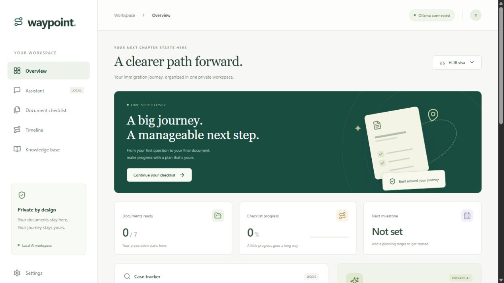

# ImmigrationBot

### Waypoint — a private U.S. immigration workspace

**Organize your next chapter with local AI, a personalized document plan, and a clear application timeline.**

ImmigrationBot is the repository for **Waypoint**, a browser-based immigration preparation assistant powered by locally installed Ollama models. Chat and document retrieval run on your own machine, without uploading your documents to ChatGPT or Claude.



> **Project status:** Working single-user local application. Local chat, document embeddings, checklist progress, PDF export, and timelines are implemented. Case-status and processing-time lookups require a configured provider adapter and credentials. Automatic1111 detection is optional; it is not the chat engine.

## At a glance

| Capability | What is included |
| --- | --- |
| Private assistant | Local Ollama chat, selectable downloaded models, conversation context, and explicit error states |
| Optional RAG | Import PDF, TXT, or Markdown; local chunking and embeddings; vector retrieval; document/chunk references |
| Case tracker | Receipt validation, provider-backed status requests, saved results, refresh by receipt, and removal |
| Processing times | Form and office filters, provider estimate and source, with no fabricated estimates |
| Personalized checklist | Visa/application path, location, dependents, translation needs, and saved completion status |
| PDF export | Download the current checklist, completed items, timeline, notice dates, and official references |
| Visual timeline | Suggested preparation dates plus separately entered dates from official notices |
| Local integrations | Ollama health/model discovery and optional Automatic1111 API/model detection |
| Interface | Responsive dashboard, keyboard-accessible controls, dialog focus management, and connection settings |

[Quick start](#run) · [Privacy](#local-ai-and-privacy) · [API setup](#case-status-and-processing-time-api-adapter) · [Application paths](#checklists-and-timeline) · [Architecture](#architecture) · [Troubleshooting](#troubleshooting)

[Download an example checklist PDF](docs/examples/sample-document-checklist.pdf) — generated from a generic H-1B preparation profile, with no applicant data or real case information.


A local React + Express application for private Ollama chat, optional retrieval augmented generation (RAG), personalized preparation checklists, PDF downloads, receipt tracking, and visual timelines.

## Run

Requires Node.js 20.19+ (or 22.12+), npm, Git, and a running local [Ollama](https://ollama.com/) installation. Node.js 22 LTS or newer is a convenient choice.

The default models are `llama3.2:latest` for chat and `nomic-embed-text-v2-moe:latest` for embeddings. Install these through Ollama if they are not already downloaded, or select compatible installed models in Settings. Model weights are not bundled in this repository.

```powershell
git clone https://github.com/vams2krish/ImmigrationBot.git
cd ImmigrationBot
npm ci
Copy-Item .env.example .env
npm run dev
```

On macOS/Linux, use `cp .env.example .env` instead of `Copy-Item`.

Open http://127.0.0.1:4317. The server binds to loopback only. No hosting or public deployment is required.

```powershell
npm run build
$env:NODE_ENV = 'production'
npm start
```

`npm test` runs domain and isolated server integration checks. Tests use synthetic providers/models and a temporary data directory; they do not modify the personal workspace. `node tests/live-smoke.mjs` optionally tests real local inference and embeddings, using a clearly marked synthetic document that is removed afterward.

## Local AI and privacy

- Chat defaults to the downloaded `llama3.2:latest` model; retrieval uses `nomic-embed-text-v2-moe:latest`. Change these in Settings.
- Both models must already be downloaded. The app never pulls models or uses a cloud fallback. Remote-backed aliases, even those named `:latest`, are excluded.
- `OLLAMA_URL` must be a loopback host. The default uses `localhost`, which also reaches Ollama's IPv6 listener on Windows.
- Uploaded PDF/TXT/Markdown files are parsed in memory, chunked, and embedded by local Ollama. Text and vectors are stored in `data/workspace.json`; original upload binaries are not retained. Scanned PDFs need OCR before import.
- RAG can be toggled off in Assistant. RAG answers show retrieved document/chunk references; the model is instructed to acknowledge insufficient evidence. Generated responses still require verification.
- Chats are held in browser memory for the current session. Case receipts are sent only to the configured case provider when tracking is requested. Files and chat text are never sent to the case provider.
- `data/` and `.env` are ignored by Git. Protect the local disk and backups: stored data is not encrypted by this app.
- This is a **single-user local implementation**, not an authenticated multi-customer production service. Add authentication, per-user data isolation, encryption, access controls and deployment review before operating for multiple customers.

## Automatic1111

Settings detects the local Automatic1111 API and installed image models at `AUTOMATIC1111_URL` (default port 7860). It was not running during setup. If you want detection, start your existing installation with its API enabled (`--api`). Automatic1111 is an image engine; immigration chat and retrieval use Ollama. No image generation is needed for the requested workflow.

## Case status and processing-time API adapter

No provider key was supplied. The app does **not** invent live results. It displays a clear connection message until configured. Configure a third-party provider or a server-side adapter for your provider's contract in `.env`, then restart:

```dotenv
CASE_API_URL=https://your-provider.example/cases/{receipt}
PROCESSING_API_URL=https://your-provider.example/processing-times
CASE_API_KEY=your-provider-token
```

These are examples of the adapter contract, not a claimed real vendor endpoint. Both requests use `Authorization: Bearer <CASE_API_KEY>` when configured. Secrets stay on the server. For a vendor using different authentication or response fields, adapt the `provider()` function and normalization in `server.js` to its documented API.

`GET CASE_API_URL` substitutes the normalized receipt into `{receipt}`. Expected JSON:

```json
{
  "form": "I-129",
  "status": "Case Was Received",
  "description": "Provider-supplied status details",
  "updatedAt": "2026-10-27"
}
```

`form` and `status` are required strings. No live sample is preloaded. Receipt validation requires three letters and ten digits. Saved cases can be refreshed by entering the same receipt again, or removed from the dashboard.

`GET PROCESSING_API_URL` adds `visa`, `form`, and `office` query parameters. Expected JSON:

```json
{
  "estimate": "Provider-supplied current estimate",
  "asOf": "2026-10-27",
  "office": "Requested service center",
  "sourceUrl": "https://egov.uscis.gov/processing-times/"
}
```

Processing-time lookup is available on the Overview dashboard and in Settings, and is specific to the requested form/office. Estimates do not predict a particular case completion date. Until a provider is configured, the UI links to official USCIS processing times. USCIS's own Case Status API is a separate integration requiring approved access; no USCIS credentials or access are implied here: https://developer.uscis.gov/api/case-status.

## Checklists and timeline

Supported preparation paths:

- H-1B petition preparation, with consular documents added for applicants outside the U.S.
- F-1 consular visa preparation (not an I-539 change-of-status checklist).
- Family-based adjustment of status inside the U.S. (not family consular processing).

Dependents and translation needs add conditional documents. These are general preparation lists, not exhaustive eligibility determinations; category-specific requirements, exemptions and filing windows must be confirmed against current official instructions. Checklists do not calculate fees or determine eligibility.

A user-selected target date generates preparation milestones at -35, -14 and 0 days, and item-specific suggested preparation dates. These are explicitly labeled **planning targets**, not government deadlines. Official notice dates can be entered separately. No USCIS deadline is inferred automatically.

Download PDF uses the same current checklist, completed items, profile, planning milestones and notice dates. It includes clickable official sources. No cloud PDF service is used.

Official reference sources:

- H-1B checklist: https://www.uscis.gov/sites/default/files/document/forms/m-735.pdf
- Student visa instructions: https://travel.state.gov/content/travel/en/us-visas/study/student-visa.html
- I-485 instructions: https://www.uscis.gov/sites/default/files/document/forms/i-485instr.pdf

## Files and configuration

- `server.js`: local HTTP server, integrations, RAG and PDF export
- `domain.js`: document rules, date arithmetic and retrieval helpers
- `src/main.jsx`, `src/style.css`: responsive workspace UI
- `tests/`: domain and server integration tests
- `.env.example`: configuration template
- `data/workspace.json`: private local persistence (created on first save)

If port 4317 is occupied, set `PORT` in `.env`. Keep the server on loopback. Large Ollama models may load slowly on memory-constrained machines; select a smaller downloaded model in Settings.


## Architecture

The application uses a React 19 interface, Vite 7, an Express 5 local server, Ollama's HTTP API, PDFKit for PDF generation, Multer for bounded in-memory uploads, and pdf-parse for text extraction.

```text
Browser on this device
  |
  +-- React dashboard, assistant, checklist, timeline, knowledge base
  |
  +-- Express API (127.0.0.1 only)
        |
        +-- Local Ollama: chat + embedding generation
        +-- Local JSON workspace: profile, vectors, document text, progress, notices, cases
        +-- PDFKit: downloadable checklist PDF
        +-- Optional case/processing provider: receipt and lookup filters only
        +-- Optional Automatic1111: health and model discovery
```

### How local RAG works

1. Import a supported text-based document through Knowledge base.
2. The server extracts text and splits it into overlapping chunks.
3. The selected local embedding model embeds each chunk.
4. Text and vectors are saved in the local workspace file.
5. With Knowledge base enabled, the assistant embeds your question and ranks compatible document chunks by cosine similarity.
6. The highest-ranking chunks are supplied to the selected local chat model as evidence.
7. The answer includes document/chunk reference metadata for inspection.

Changing the embedding model requires reimporting documents so their vectors use the same model. Retrieval references are not a guarantee of factual or legal correctness; review the actual source and current official instructions.

### Configuration reference

Copy `.env.example` to `.env` and restart after changing server configuration.

| Variable | Default / purpose |
| --- | --- |
| `PORT` | `4317`; local application port |
| `OLLAMA_URL` | `http://localhost:11434`; must be a loopback host |
| `OLLAMA_MODEL` | `llama3.2:latest`; initial chat model for a new workspace |
| `OLLAMA_EMBED_MODEL` | `nomic-embed-text-v2-moe:latest`; initial embedding model |
| `AUTOMATIC1111_URL` | `http://127.0.0.1:7860`; optional image-engine discovery |
| `CASE_API_URL` | Optional adapter URL containing `{receipt}` |
| `PROCESSING_API_URL` | Optional adapter URL accepting form, office, and visa query parameters |
| `CASE_API_KEY` | Optional server-side bearer token used by the provider adapter |
| `APP_TIMEZONE` | `America/Los_Angeles`; date used in PDF exports |
| `DATA_DIR` | Optional private workspace directory; defaults to `data/` |
| `NODE_ENV` | Set to `production` to serve the built `dist/` application |

After a workspace is created, its model choices are saved in the workspace. Change those in Settings; environment defaults do not overwrite saved selections.

### Local HTTP endpoints

| Method | Endpoint | Purpose |
| --- | --- | --- |
| GET | `/api/workspace` | Profile, checklist, milestones, saved cases, document metadata |
| GET | `/api/health` | Local AI, installed models, optional image engine, provider configuration |
| PUT | `/api/profile` | Save preparation path and personal planning options |
| PUT | `/api/completed` | Save completed checklist item IDs |
| PUT | `/api/settings` | Select downloaded local chat and embedding models |
| POST | `/api/documents` | Import one PDF/TXT/Markdown file as multipart field `file` |
| DELETE | `/api/documents/:id` | Remove an imported document and its stored chunks/vectors |
| POST | `/api/chat` | Ask a question with optional retrieval and recent conversation context |
| POST | `/api/cases` | Look up and save a provider-backed receipt status |
| DELETE | `/api/cases/:receipt` | Remove a saved case |
| GET | `/api/processing` | Request a provider estimate with `form` and `office` filters |
| POST | `/api/notices` | Add a user-entered notice title and date |
| DELETE | `/api/notices/:id` | Remove a notice date |
| GET | `/api/checklist.pdf` | Download the current preparation checklist |

These endpoints are designed for this single local workspace. They are not a public authenticated service API.

## Validation

```powershell
npm test
npm run build
```

The automated suite covers receipt validation, conditional document rules, calendar-date arithmetic and invalid dates, retrieval scoring/chunking, local-model filtering (including cloud-backed aliases), provider adapters, document import/retrieval/deletion, citations, persistence, PDF signatures, and cross-origin mutation rejection.

The application was also checked in a browser, exported PDF pages were rendered and visually inspected, and real local Ollama chat and embedding requests were exercised. Provider integration tests use synthetic responses; no live third-party case-status service is represented as configured. Model startup latency depends on hardware and available memory.

## Troubleshooting

| Symptom | What to check |
| --- | --- |
| Ollama offline | Start Ollama and check `OLLAMA_URL`; the Windows listener may require `localhost` rather than `127.0.0.1` |
| Model not available | Select a downloaded local model in Settings; cloud models and remote aliases are rejected |
| Chat takes too long | Allow for a cold model load, free memory, or select a smaller installed chat model |
| Model returns no final answer | Choose a compatible non-thinking chat model or retry a shorter question |
| Document import fails | Use PDF/TXT/Markdown under 10 MB with readable text; OCR scanned pages before import |
| RAG stops after a model change | Reimport documents with the current embedding model |
| Case tracker says not configured | Set the provider URLs/token, implement any vendor-specific mapping, and restart |
| Address already in use | Choose another free `PORT` in `.env` |
| Automatic1111 not running | Start the existing installation with API access enabled; chat does not require it |
| Workspace data unreadable | Restore the private workspace file from a trusted backup; corrupted data is not silently reset |

## Scope and next steps

Implemented functionality is described above. Multi-user accounts, authentication, encrypted storage, a managed vector database, automatic official-source refresh, notifications, automatic government-deadline calculation, OCR, additional immigration categories, and a specific vendor's production case-status integration are **not implemented**.

Before serving multiple customers, add authenticated tenant isolation, secure storage and backups, access controls, retention controls, and a reviewed deployment architecture. Do not expose this unauthenticated local server to the internet.

This project provides general preparation information, not legal advice or an eligibility determination. Consult current official guidance and qualified immigration counsel for individual cases.
